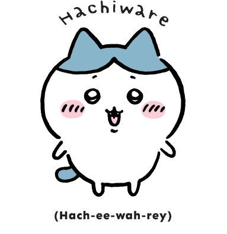
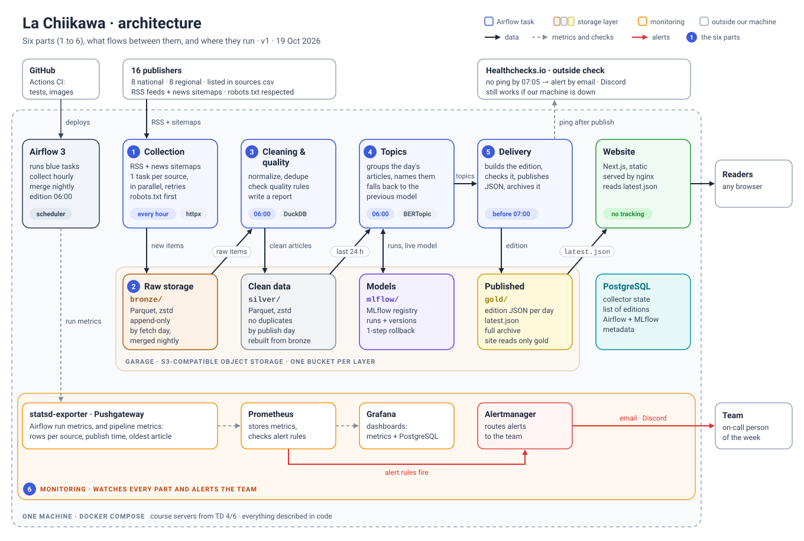

# La Chiikawa: project scope

> M2Ops project "La gazette" · M2 Data Engineering & AI · Efrei 2026-2027
> Version 1, 19 October 2026 · Adrien Chuembou Mbah, Quand Dat Lee

  
  
  

Chiikawa, Hachiware and Usagi — characters © Nagano, used only as the project mascot.

## The need

Every morning at 7:00, *La Chiikawa* publishes the main topics covered since the day before by French regional (PQR) and national (PQN) newspapers: what the topics are, which newspapers talk about them, and links to read more.

The hard part is running it. The pipeline must run on its own every morning, and we must be able to prove that it ran, with metrics, alerts and a logbook.

## Scope

| In | Out |
|---|---|
| Titles, short excerpts, links and dates from 16 checked sources (8 national, 8 regional), listed in `sources.csv` | Full article text, images, comments, scraping web pages |
| Raw, clean and published data kept in three layers, with written data quality rules | Personal data: no author names, no user accounts, no visitor tracking |
| Grouping articles into topics, with every run tracked and versioned | Article summaries written by an LLM |
| One edition per day, shown on a Next.js website and archived | Real-time updates, paid sources |
| Monitoring, CI/CD, infrastructure as code | |

## Constraints

- **Service:** the edition is online at 7:00 (Paris time) and only contains articles less than 24 hours old. Every day we measure the publication time, the age of the oldest article, and the share of sources collected.
- **Access:** only RSS feeds and news sitemaps, following each publisher's terms.
- **Polite collection:** our bot uses its real name (`Chiikawa_efrei/1.0`), checks `robots.txt` before each request, waits as long as each site asks (`Crawl-delay`), and never pretends to be a browser or another bot.
- **Zero budget:** free or open-source tools only, our own computers until the course gives us servers (TD 4 or 6), and everything that runs is described in code.

**What we found when checking the sources on 19/10:**

- Six newspapers block bots (Ouest-France, Le Télégramme, La Voix du Nord, Courrier picard, Les Échos, Sud Ouest). So we have no regional paper for Brittany, Normandy, Hauts-de-France or Nouvelle-Aquitaine.
- Two formats: L'Humanité forbids bots on its RSS feed, Le Parisien's RSS has no dates, and 20 Minutes' RSS contains the full article text. For these we use the news sitemap instead, and the collector keeps only a fixed list of allowed fields.
- Duplicates: the EBRA group papers share articles, and the same article can appear in both RSS and sitemap. We remove duplicates using the clean article URL.
- Short feeds (Le Monde shows only 16 articles): we collect every hour, not once in the morning.
- Le Monde and Libération say in their `robots.txt` that any use beyond personal use needs a licence. We must check with the teacher.

## Architecture

Six parts, all running in Docker containers.

1. **Collection**, every hour: one Airflow task per source, running in parallel, with retries.
2. **Raw storage (bronze)**: each new item as received, with its source and run, in Parquet files that are never changed.
3. **Cleaning and quality (silver)**, at 6:00: clean up, remove duplicates, check the rules, write a report.
4. **Topics**: BERTopic, using the model version currently live in the MLflow registry.
5. **Delivery (gold)**: the day's edition is built, checked and published as a JSON file before 7:00, then shown by the Next.js website.
6. **Monitoring**: metrics, alerts and an outside check that watch the five other parts.

**One failure does not stop everything.** Each source runs on its own. The edition still goes out if some sources are missing, with a warning banner and an alert. If the topic model fails, the previous version is used. If the website goes down, the edition is still built and archived.

### Data storage

We use the layered "medallion" pattern common in data teams: raw data (bronze), clean data (silver), data ready to publish (gold).

- **Data in files, state in a database.** Bronze and silver are Parquet files compressed with zstd, in S3-compatible object storage run by Garage. PostgreSQL only keeps small state: items the collector has already seen, the last ETag of each feed, failures in a row, the list of editions, and Airflow's and MLflow's own data.
- **One bucket per layer.** The website can read `gold` and nothing else.
- **Folders by date.** Bronze is split by the day we fetched the item (`ingest_date=…`), silver by the day it was published (`published_date=…`). The 6:00 run reads only the last two days.
- **Safe to run again.** Every file is named after its source and its run, so a retry replaces the same file instead of adding a copy. A silver day is always rewritten as a whole.
- **No pile of small files.** Hourly runs make 16 small files an hour. Every night, a job merges each day into one file and removes duplicates.
- **We can rebuild.** If a cleaning rule changes, we rebuild silver from bronze.
- **Allowed fields only.** Companies often keep the full HTTP response in bronze. We can't, because some feeds include the full article text. Bronze keeps the allowed fields exactly as received.

## Tools chosen

| Part | Chosen | Rejected, and why |
|---|---|---|
| Containers | Docker, Docker Compose | Kubernetes (too much for one machine); Podman (Compose works less well on Windows) |
| CI/CD | GitHub Actions: lint, tests, image builds | GitLab CI (similar, depends on where the code lives); Jenkins (one more server to maintain) |
| Scheduling | Airflow 3, LocalExecutor | cron (no retries, no parallel runs, no run history); Prefect (less widely used) |
| Collection | Python: httpx, feedparser, protego | Scrapy (made for scraping); `urllib.robotparser` (ignores `*` wildcards, seen on 19/10) |
| Data files | Parquet (zstd) for bronze and silver; JSON for the published edition | CSV or JSON for everything (no types, larger, slower to read); PostgreSQL for all data (history grows in the same database as Airflow and MLflow, so one problem hits everything) |
| Table format | None for now: plain Parquet folders | Apache Iceberg or Delta Lake (useful with several writers at once or to go back in time; we have one writer per folder and a few MB a day, so they are our next step, not our start) |
| Object storage | Garage: S3-compatible, self-hosted, light | MinIO (free edition archived in 2026, no maintained images); local disk (no S3 API, so the code would change on the servers) |
| Processing | DuckDB: SQL on Parquet, runs inside each task, no server | Spark (a cluster for a few MB a day); pandas (no SQL, loads everything in memory) |
| State and serving | PostgreSQL | SQLite (no parallel writes); state files in object storage (no transactions, two tasks can overwrite each other) |
| Topics | BERTopic, multilingual embeddings | LDA (weak on short titles); TF-IDF + KMeans (kept as a baseline to compare against) |
| ML tracking | MLflow: runs, model registry, rollback; models stored in object storage | Weights & Biases (online service, our data leaves our machines); ClearML (self-hosted, but needs several more services) |
| Website | Next.js static export, served by nginx | Streamlit (limited user experience); plain HTML with Jinja2 (poor user experience) |
| Monitoring | Prometheus, Grafana, Alertmanager to email and Discord; outside check with Healthchecks.io | ELK (uses too much memory); Datadog (paid) |
| Infrastructure as code | Compose and config files in Git from TD 2, including Garage's one-time setup (buckets, keys); Terraform or Ansible depending on the servers given at TD 4/6 | Pulumi (to look at again later); manual setup (not allowed) |

Why an outside check: if our machine stops, Airflow and Prometheus stop with it. Only an outside service can notice that the edition did not come out.

## Risks

| Risk | What we do |
|---|---|
| A source changes format or blocks us | Each source runs alone; alert after 3 failures in a row; 16 sources when 8 are required; sitemap as backup for RSS |
| Machine is off at 7:00 (before we get servers) | One chosen machine stays on; the outside check alerts us; catch-up steps written in the runbook |
| Clocks go back on 25/10 | Schedules set in Paris time, all stored dates in UTC, checked on 26/10 |
| Topics are hard to read | Remove duplicates first, measure topic quality, compare with the TF-IDF + KMeans baseline |
| Too many small files (16 sources × 24 runs a day) | Nightly merge into one file per day |
| A storage tool is abandoned, as MinIO was in 2026 | We only use the standard S3 API, so another S3 store can replace Garage without code changes |
| Only two people, plus a website | The website never blocks publication; reliability comes first; we review each other's code |
| Le Monde and Libération terms | Ask the teacher; a source can be turned off in config |

## Roles

| Member | In charge of | Skills |
|---|---|---|
| Adrien Chuembou Mbah | Collection and the whole pipeline: scheduling, storage, quality, CI/CD, monitoring, infrastructure as code | C7.1 · C7.2 · C7.3 · C8.1 · C8.2 |
| Quand Dat Lee | Topics (BERTopic, MLflow) and the Next.js website | C7.4 · C7.3 (delivery) |

From TD 7, we take turns each week as the person on call for operations.

## To check with the teacher

- We are a team of two, but the course asks for 3 or 4.
- Whether we can use Le Monde and Libération.
- Which servers we get at TD 4 or 6. That decides between Terraform and Ansible.
