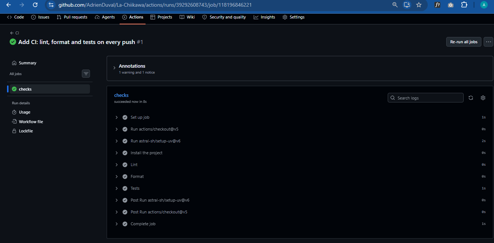
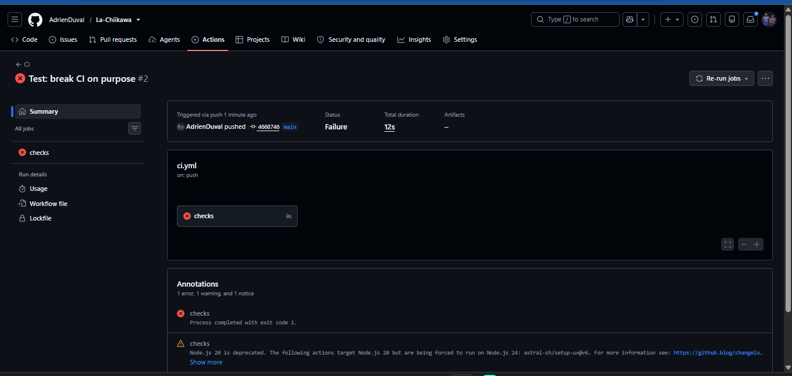

# CI/CD

## What the CI does

The CI runs on GitHub Actions (`.github/workflows/ci.yml`) on every push to `main` and on every pull request.

| Job | Steps | Fails when |
|---|---|---|
| `checks` | Install the exact locked libraries (`uv sync --locked`), lint (`ruff check`), format check (`ruff format --check`), tests (`pytest`) | `uv.lock` is out of date, ruff finds a problem, the code is not formatted, or a test fails |
| `docker` | Build the image, then run it | The Dockerfile is broken, or the image does not start |

The `docker` job waits for `checks` (`needs: checks`): there is no point packaging code that is already known to be broken.

When a step fails, the following steps are skipped and the commit shows a red ❌ on GitHub.

## How we work

Before every push, we run the same checks locally:

```bash
uv run ruff check .
uv run ruff format --check .
uv run pytest
```

The CI runs them again on a clean machine, which proves the result does not depend on one laptop.

**We pin versions** (`uv.lock`, `ubuntu-24.04`, `setup-uv@v7`, `postgres:17`, `garage:v2.2.0`) so that nothing changes unless we decide it. A version that moves on its own (like `ubuntu-latest`) can break the pipeline for no visible reason.

Secrets never go in Git: real values live in `.env` (ignored), and `.env.example` lists the settings with placeholders.

## Local infrastructure

`compose.yml` describes what runs on our machine:

- **PostgreSQL 17**: small state (collector state, list of editions, Airflow and MLflow data). Data kept in a volume.
- **Garage v2.2.0**: S3-compatible object storage with the buckets `bronze`, `silver`, `gold` and `mlflow`.

`scripts/init-garage.sh` sets Garage up (layout, buckets, app key). It is safe to run again: it only creates what is missing, and stops with a clear error after 30 seconds if Garage does not answer.

```bash
docker compose up -d
bash scripts/init-garage.sh
```

## Proof

First CI run, green:



A test broken on purpose blocks the build:



## Tool choices

| Need | Chosen | Rejected, and why |
|---|---|---|
| Python version and libraries | uv | pip + requirements.txt (does not lock the libraries our libraries use); Poetry (locks them, but slower) |
| Lint and format | ruff | flake8 + black + isort (three tools for what ruff does alone, and slower); pylint (much slower, noisier) |
| CI | GitHub Actions | GitLab CI (similar, but our code is on GitHub); Jenkins (one more server to install and maintain) |
| Containers | Docker + Docker Compose | Podman (Compose works less well on Windows); Kubernetes (too much for one machine) |
| Object storage | Garage | MinIO (free edition archived in 2026, no maintained images); a local folder (not shared between containers, not the S3 standard) |
| Database | PostgreSQL | SQLite (no parallel writes); MongoDB (we need SQL, and JSONB covers flexible data) |

## Not automated yet

- After `init-garage.sh` creates the app key, its Key ID and Secret must be copied into `.env` by hand.
- There is no deployment yet: the CI checks and packages the code, but nothing is sent to a server. This comes when the course servers are available (TD 4 or 6).
- The CI does not start PostgreSQL or Garage, so there are no integration tests yet.
